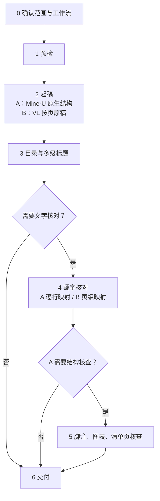

# md1012：历史研究文献整理

目标是让正文可核对、可检索、可引用。本文件是入口：先定任务范围和工作流，再按主流程走。共用规则（保真、页码、目录结构、服务、交付）只在本文件写一次；其余文档只写各步的操作。

## 一、先定两件事

### 任务范围

| 范围 | 做法 |
|---|---|
| 新建整理 | 按请求的页或全书走主流程 |
| 已有结果重建或校订 | 复用已有 PDF、原始结果、书配置和原稿，缺哪项补哪项 |
| 局部或只读检查 | 只比较、截图或定位请求页，写到指定目录；不重跑全书，不联网查凭据，不改正文，不出全书改动报告 |

与本次无关的配置（模型查新偏好、全局库路径、本次不用的服务凭据）不是前置条件。本书已记录的字形方针和已给的授权不再重复询问。

### 工作流：看页面是不是现代重新排字

| 工作流 | 适用材料 | 默认验收 | 分支文档 |
|---|---|---|---|
| **A：论文和现代出版物** | 论文、研究专著、教材、现代重新排字的点校/整理古籍 | 文字、脚注及其引用关系、多级标题、页码、图表、原有标点；通常逐行定位 | [modern-publications.md](references/modern-publications.md) |
| **B：非现代排印古籍** | 刻本、旧刊本、抄本、稿本等原页的扫描或影印 | 页码/叶码、多级标题、识字准确；保留原有夹注文字；默认页级定位 | [historical-editions.md](references/historical-editions.md) |

- 现代竖排排印的古籍走 A。MinerU 识字差时可以换识字来源，但仍按 A 验收。
- 现代出版的旧版影印集没有重新排字，走 B。
- 横竖排、有无标点、出版年份都不决定分流。档案、报刊、混合汇编看具体页面；一本 PDF 可以分段走不同工作流，报告标明范围。归不了类时向用户说明差异再定。

## 二、主流程

只执行本次范围内的步骤。例如局部目录检查做完第 3 步就交付，不以解析、核字、映射为前提。



| 步骤 | 两条共同的做法 | A 的做法 | B 的做法 | 细节 |
|---|---|---|---|---|
| 1 预检 | 本地预检，抽看目录、正文、注区、图表、难字页 | 竖排本先看结构分类是否可用 | 手写本、特殊行款先抽样 | 分支文档 |
| 2 起稿 | 保留原始响应；已有缓存直接用 | MinerU 结构为底稿，从 `layout.json` / `*_middle.json` 恢复脚注、页码、图表 | VL 按页起稿；也可直接按页转录 | 分支文档 |
| 3 目录与标题 | AI 看目录原图出候选标题树，核正文后再改层级 | 同左 | 同左 | [toc-headings.md](references/toc-headings.md) |
| 4 疑字核对 | 第二读者比对 → 截图 → 看原图判定 → 安全执行 | 通常 VL 作第二读者，逐行映射 | 通常看典作第二读者，页级映射 | [doubt-check.md](references/doubt-check.md) |
| 5 结构核查 | 只做本次需要的项目 | 脚注、篇题、清单页、残留 | 默认不做，用户要求才做 | [structure-audit.md](references/structure-audit.md) |
| 6 交付 | 成品、校注、改动报告、未判项 | 另报脚注、图表、结构 | 不以精细版面为完成条件 | 本文件第七节 |

**改正文的先后**：标题层级或正文一改，映射就过期。要么先执行当前有效的疑字批次再改结构，要么改完结构后重建映射、重新比对截图；不能在生成偏移和执行改字之间改正文。

## 三、识别来源各管什么

| 来源 | 用途 | 接口文档 |
|---|---|---|
| MinerU | A 的结构底稿：区域框、分类、读序、脚注、图表 | [mineru-api.md](references/mineru-api.md)、[mineru-outputs.md](references/mineru-outputs.md) |
| PaddleOCR-VL | B 的按页起稿；A 的第二读者，或 MinerU 失效时的替代识字 | [vl.md](references/vl.md) |
| 看典 | B 的第二读者；A 用 VL 文字时也可选用 | [guji-apis.md](references/guji-apis.md) |
| 古籍酷 Chat | 用户指定时的备用接口 | [guji-apis.md](references/guji-apis.md) |

- MinerU 识字差时，仍检查它的框、分类和读序哪些可用，不因字差弃用全部结构；有框也不等于分类正确。
- 不要求通用结构适配层，也不要求 B 复刻 MinerU 的版面系统。
- 模型输出、脚本推断、已核原图的事实三者分开标明。疑似书眉、编造、卷号异常先列候选；不自动改卷号，不静默删可疑正文。
- 新材料先抽样核图再大批调用。

## 四、保真规则

1. 以本次所据原件为准。OCR 错读、漏读可按原图纠正；原刊自身误印、疑脱字默认照录并列疑问，未经用户许可不改成"应有"的文字，不用别的版本补正文。
2. 原书有标点照录，无标点不补；不按语言模型的文意补标点。
3. 原有夹注、附注、缺字框和难以转录的内容不丢弃。B 可以只保留文字和原图位置，不恢复复杂脚注链接；A 按出版物实际的注释关系验收。
4. 字形方针先查本书记录（`config.json` 的字形表与校注），只有本次需要新决策时才问。无论保留原字形还是统一规范字形，替换都要有原图依据并记校注。比对时的字形折叠不等于改正文。
5. 内容层修改逐处记录原字、改字、位置和依据；校注与正文分开，改动报告由脚本生成。已入库正文和用户标注默认只读，获授权的校订才写回。
6. 两家读法不一致只是疑字线索，一致也不证明无误。未经整页或整书核验，不报全书准确率；只有一家读者时，报告注明没有第二读者覆盖。

## 五、页码口径

| 标记 | 含义 |
|---|---|
| `<!--pdf-page.N-->` | 原 PDF 物理页序（1 起）。每页都要有 |
| `<!--p.N-->` | 已核定的原书印刷页码 |
| `<!--leaf.三上-->` | 原书叶码，照录 |

- 三种口径不混称。没有可靠原书页码时，明确说只有 PDF 页序；不把推算值当原书页码。
- OCR 读到但未核定的页码写进报告，不写进正文标记。
- 目录上的页码是印刷页，不是 PDF 页序。缺页、页码跳变要核原件，不自动补成连续。
- 从原 PDF 抽出小 PDF 测试时，锚点仍写原 PDF 的页号。

## 六、书目录与命令约定

命令一律在 PowerShell 里运行，写作 `python -X utf8 <skill>/scripts/<脚本>.py`。占位符：`<skill>` 是本 skill 目录，`<书>` 是一本书的文件夹，`<原件>.pdf` 是书文件夹里的原 PDF。

```text
<书>/
├─ <原件>.pdf                 原件，只读
├─ 00-卷首.md、01-正文.md…    成品正文（split_book.py 拆出）
├─ <书名>.AI校注.md           校注，与正文分开
└─ _数据/
   ├─ config.json             书配置：PDF、正文文件、页码偏移、书写方向、字形表
   ├─ MinerU/ VL/ 看典/        各家原始结果，不删
   ├─ 目录与标题/outline.json  候选标题树与核对状态
   ├─ 页级映射/ 或 逐行映射/   line-map.json
   ├─ 疑字判定/                比对、截图、判定、执行状态（每批一个子目录）
   ├─ 注区审核/ 补注/ 补篇题/ 残留清理/   结构核查（按需）
   └─ 过程报告/                脚本报告、按页原稿、骨架
```

已有的书沿用它原来的目录名，不为套用本结构而搬动。`config.json` 的字段见 [structure-audit.md](references/structure-audit.md)；frontmatter、校注、索引格式见 [templates.md](references/templates.md)。

## 七、服务、输出与交付

**服务与凭据**：只向本次任务已授权的服务上传 PDF，已有授权不重复问；用缓存完成的任务不上传。密钥不贴进聊天、不写进仓库；缺凭据时才用对应脚本的 `configure` 在本机隐藏输入。只配置本次要用的服务，不为整理文献建定期任务。

**输出位置**：优先照本次要求；没有要求就复用已有书目录；仍不明确才问。原始响应、原稿快照、校注、目录标题树和报告集中保留，不擅自删除下载文件、备份、执行状态或用户资料。

**交付报告**按本次范围写：

- 所选工作流、处理页与未处理页、页码口径；
- 目录与标题的对应情况；
- 文字核对的范围和第二读者覆盖；
- 改动及依据、未判疑字和缺口；
- A 另报脚注、图表与结构；B 不以未请求的精细版面功能作为完成条件。

只有抽样结果时写明是抽样，不说成全书校订完成；接口调用成功不等于校订完成。
