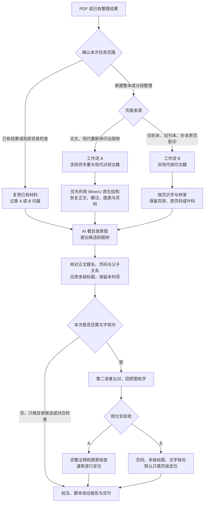

# md1012：两条工作流

以页面是否现代重新排印为主要分流依据，横竖排与文字层质量用于各流程内的技术选择。两条流程都采用 AI 读目录原图辅助建立多级标题。

此图给出可选阶段，实际只执行本次请求范围。局部目录候选检查可以复用现有图像和正文，交付候选及对应结果就结束，不以解析、核字、映射或改文为前置。

目录不存在时，AI 根据正文显式标题形式提出层级，注明依据；不伪造目录。目录未列细标题、目录与正文异名、缺题或缺页分别处理，见 [toc-headings.md](toc-headings.md)。

现代竖排排印本仍走 A；现代出版的影印集未重新排字则走 B。混合材料可分段记录。A 的结构若部分失效可换识字来源再核出版物结构；B 不要求建立一套通用版面引擎。没有做的文字/标题核查如实列明。
